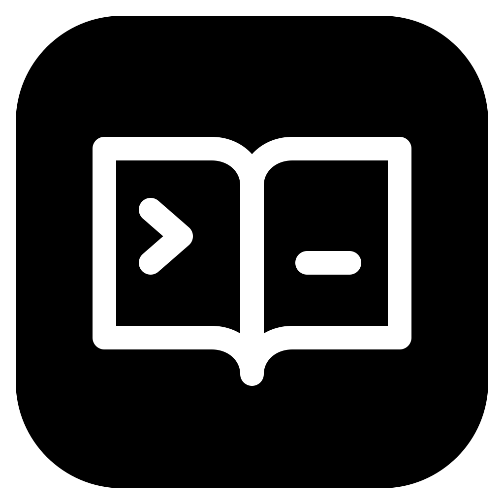

<div align="center">



# lms-cli

**Multi-school Canvas & Blackboard CLI and read-only MCP server for Codex, Claude Code, and terminal workflows.**

[](https://github.com/zs-andy/lms-cli/actions/workflows/ci.yml)
[](https://github.com/zs-andy/lms-cli/actions/workflows/security.yml)
[](https://github.com/zs-andy/lms-cli/releases)
[](LICENSE)
[](package.json)

**English** | [简体中文](README.zh-CN.md) · [Compatibility](docs/COMPATIBILITY.md) · [Roadmap](docs/ROADMAP.md) · [Discussions](https://github.com/zs-andy/lms-cli/discussions)

</div>

---

Query courses, announcements, assignments, grades, files, and calendars across **Canvas** and **Blackboard** from a single terminal interface — or expose them safely to AI agents via read-only **Model Context Protocol (MCP)** tools.

Installation, school discovery, profile setup, and updates all happen directly in the terminal. A local sign-in window opens only when your university SSO or MFA requires interactive authentication.

## Highlights

- **Multi-school & multi-platform**: Search official Canvas school directories, use built-in presets, or connect any school by HTTPS URL; isolate credentials, caches, and local todos per profile.
- **Agent-ready via MCP**: First-class plugins for **Codex** (`plugins/lms-cli/`) and **Claude Code** (`plugins/lms-cli-claude/`), plus standard `lms mcp` stdio support for any MCP client.
- **Strictly read-only by design**: Explicit tool allowlist and JSON Schema validation — never submits assignments, starts exams, sends messages, or mutates LMS data.
- **Local-first security**: Sessions and local todos are encrypted on disk with keys managed by your OS keychain (`@napi-rs/keyring`); SHA-256 verified standalone releases with resumable updates.
- **Deadline tracking & ICS export**: Track schedule/deadline changes spotted in announcements and export local todos to `.ics` calendars.

## Architecture

```text
Terminal / Codex / Claude Code / MCP Client
                   │
                   ▼
         cli.ts  /  mcp.ts   ◄── config · auth · local todos
                   │
                   ▼
      backend.ts + policy.ts  (read-only allowlist · schema validation · cache)
                   │
                   ▼
     worker.ts  (isolated per profile × platform) ──► vault.ts (OS keychain)
                   │
                   ▼
    platforms/{canvas,blackboard}/runtime.ts  ──► University HTTPS API
```

Every LMS platform is registered once in `src/platforms/registry.ts` — CLI flags, MCP schemas, login policies, and overview planners are all derived from it. See [docs/ARCHITECTURE.md](docs/ARCHITECTURE.md).

## Quick Start

### 1. Install

**macOS / Linux:**

```sh
curl -fsSL --proto '=https' https://raw.githubusercontent.com/zs-andy/lms-cli/main/install.sh | sh
```

**Windows (PowerShell):**

```powershell
& ([scriptblock]::Create((Invoke-WebRequest -UseBasicParsing https://raw.githubusercontent.com/zs-andy/lms-cli/main/install.ps1).Content))
```

The installer downloads the matching self-contained archive from [GitHub Releases](https://github.com/zs-andy/lms-cli/releases), verifies `SHA256SUMS.txt`, and installs into your user directory with bundled Node.js — no admin rights, Node, npm, or Git required. For unsupported targets, see [building from source](docs/DEVELOPMENT.md).

### 2. Discover & Connect Your School

```sh
lms setup
```

Search by school name or domain, confirm the platform URL and time zone, connect Codex (optional), and complete school sign-in. Useful flags:

```sh
lms setup --school "Hong Kong"   # Search and add a school
lms setup --manual               # Enter a Canvas/Blackboard URL directly
lms setup --no-codex             # Standalone CLI without Codex plugin
lms setup --no-login             # Local profile setup only
```

### 3. Query Courses, Deadlines & Files

```sh
lms canvas courses
lms blackboard courses
lms overview --days 7 --fresh
lms download <file-id> --directory /absolute/destination
```

### Use with Claude Code

After running `lms setup --no-codex`:

```sh
claude plugin marketplace add zs-andy/lms-cli
claude plugin install lms-cli@lms-cli
```

Or register the MCP server directly (do not enable both at once):

```sh
claude mcp add --scope user lms -- lms mcp
```

Read-only `lms` tools carry MCP read-only annotations; local configuration/login/download tools (`lms_profile_add`, `lms_profile_use`, `lms_auth_login`, `lms_items_upsert`, `lms_download_file`) should remain confirmation-gated.

### Updates

```sh
lms update --check      # Check for a newer stable release
lms update              # Download (with resume & SHA-256 check) and upgrade
lms update --rollback   # Revert to the previous version
```

Set `LMS_UPDATE_CHECK=0` to disable automatic update checks.

## Experimental Sign-In Options

When re-authentication is needed, `lms-cli` always opens your school's genuine SSO/login page. Optional, off-by-default **Remember Password** and **Auto Sign-In** toggles are available for standard forms, multi-step sign-in flows, and Microsoft ADFS (such as PolyU). Credentials are encrypted locally only after verified authentication; CAPTCHA, push MFA, and device compliance remain controlled by your school. See [docs/USER_GUIDE.md](docs/USER_GUIDE.md) for details and cleanup instructions.

### Background Reauthorization

After enabling both **Remember Password** and **Auto Sign-In** interactively, scheduled CLI or MCP runs can opt into hidden reauthorization with `LMS_AUTH_BACKGROUND=1`:

```sh
LMS_AUTH_BACKGROUND=1 lms overview --days 7 --fresh
LMS_AUTH_BACKGROUND=1 lms auth login
```

This keeps the authorization controller, school SSO child windows, and JavaScript dialogs hidden without stealing focus (and suppresses the macOS Dock icon). Each platform is capped at 45 seconds and continues to remaining platforms on failure. Without existing consent—or on MFA, CAPTCHA, network errors, or unsupported forms—it fails closed with `state: "cancelled"` instead of popping up a window; repair interactively by running `lms auth login` with `LMS_AUTH_BACKGROUND` unset. Note that background mode hides windows within a graphical desktop session; headless Linux without a display server (or Xvfb) and OS Secret Service remains unsupported.

## Documentation

- **Users**: [User Guide](docs/USER_GUIDE.md) · [Schools & Multi-Account Setup](docs/SCHOOLS.md) · [School Compatibility Matrix](docs/COMPATIBILITY.md) · [Install Options](docs/CLI_INSTALL.md) · [Privacy](PRIVACY.md) · [Security](SECURITY.md)
- **Contributors**: [Contributing Guide](CONTRIBUTING.md) · [Code of Conduct](CODE_OF_CONDUCT.md) · [Roadmap](docs/ROADMAP.md) · [Changelog](CHANGELOG.md) · [Development Guide](docs/DEVELOPMENT.md) · [Architecture](docs/ARCHITECTURE.md) · [Adding a New LMS Platform](docs/ADDING_A_PLATFORM.md) · [Releasing](docs/RELEASING.md)

## Contributing

Contributions are very welcome! Great places to jump in:

- **Report your university's compatibility** in [Discussions](https://github.com/zs-andy/lms-cli/discussions) or [docs/COMPATIBILITY.md](docs/COMPATIBILITY.md), or add verified school presets.
- **Pick up starter issues** labeled [`good first issue`](https://github.com/zs-andy/lms-cli/labels/good%20first%20issue) or [`help wanted`](https://github.com/zs-andy/lms-cli/labels/help%20wanted).
- **Add a new LMS platform** (e.g., Moodle, Brightspace, Sakai) using the template in `src/platforms/_template/` and [docs/ADDING_A_PLATFORM.md](docs/ADDING_A_PLATFORM.md).
- **Improve cross-platform installers & tests** across macOS, Linux, and Windows.

Run the offline check & test suite locally (no university account required):

```sh
npm ci
node node_modules/electron/install.js
npm run check:repo && npm run typecheck && npm test
```

See [CONTRIBUTING.md](CONTRIBUTING.md) and [CODE_OF_CONDUCT.md](CODE_OF_CONDUCT.md) before opening a pull request.

## Disclaimer & License

Independent community project with no affiliation to any university, Instructure, Anthology, or OpenAI. Connectors build on [canvas-student-mcp](https://github.com/xmike04/canvas-student-mcp) and [blackboard-mcp](https://github.com/felipedias-ie/blackboard-mcp); see [THIRD_PARTY_NOTICES.md](THIRD_PARTY_NOTICES.md).

Licensed under the [MIT License](LICENSE).
